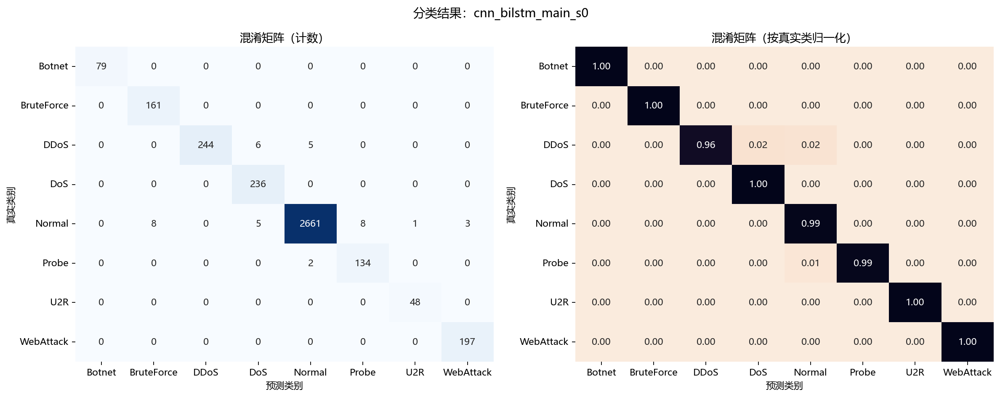
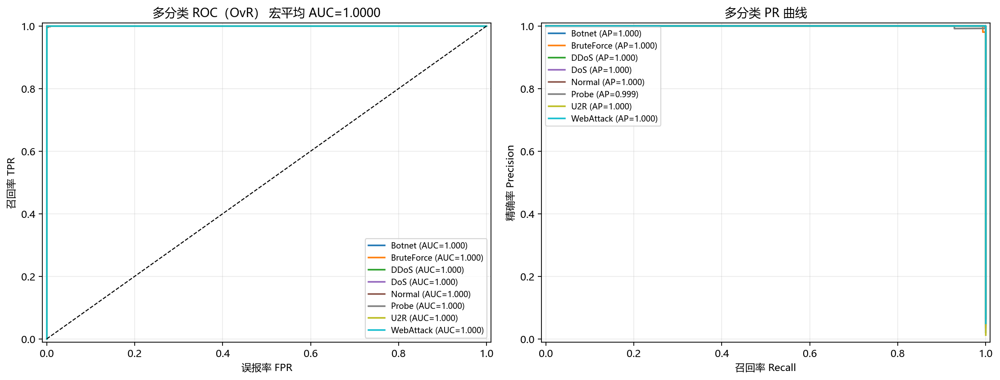
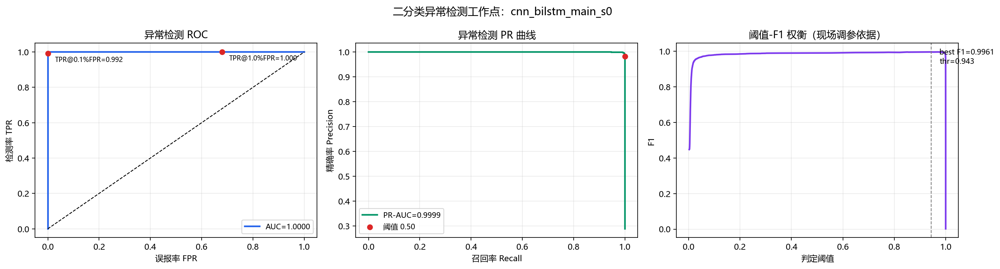
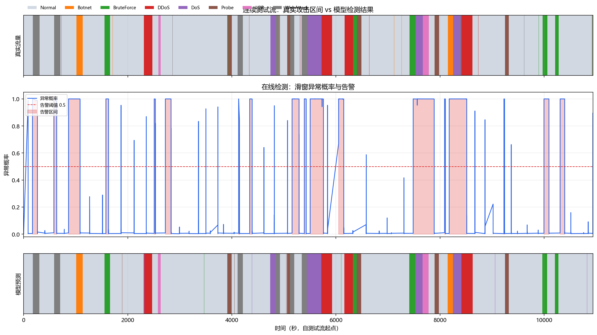
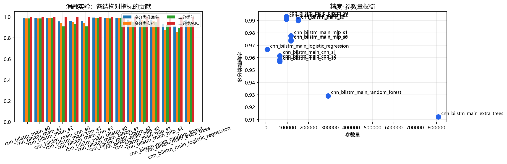

# 实验报告：基于 CNN + BiLSTM 的 SDN 流量异常检测

> 本报告由 `tools/make_report.py` 依据真实实验产物自动生成（2026-09-13 00:56）。
> 实验标签：`cnn_bilstm_main_s0`；全部数字取自 `results/` 与 `artifacts/`，可逐项复现。

## 摘要

本文针对 SDN 环境下的网络入侵与异常流量检测问题，提出并实现了一个 **CNN + BiLSTM 混合模型**：以连续 16 条流记录构成的滑动窗口为输入，CNN 提取窗口内的局部行为模式，BiLSTM 建模时间依赖，末端采用**多分类头 + 二分类头**的多任务结构并引入时间维注意力池化。在 8 类流量（正常 + 7 类攻击）的测试集上，多分类准确率 **0.9952**、宏平均 F1 **0.9930**；二分类异常检测 ROC-AUC **1.0000**、F1 **0.9907**、PR-AUC **0.9999**、TPR@FPR=1% **1.0000**。在连续测试流的在线模拟中，攻击片段召回率 **1.0000**，平均检测时延 **0.02 秒**，误报率 **0.66 次/小时**。

**关键词**：SDN；入侵检测；CNN；BiLSTM；注意力机制；多任务学习；滑动窗口

## 1. 数据

### 1.1 数据来源与格式

实验数据由本工程自带的仿真流量生成器产生（`--set source=synthetic`），schema = `insdn`：84 列，列名与公开数据集 inSDN / CIC-IDS2017（CICFlowMeter 输出）**逐字一致**。

生成器先按攻击机理生成「流记录的物理事实」（包数、字节数、时长、标志位、到达间隔、活跃/空闲时间……），再由同一份事实渲染出数据集列，因此任意两个特征之间物理自洽；同时可通过 `overlap_ratio`（类别重叠困难样本比例）、`label_noise`（标注噪声）、`drift_strength`（分布漂移）三个旋钮控制任务难度，避免指标虚高。

### 1.2 规模与切分

| 项目 | 数值 |
|---|---|
| 类别数 | 8 |
| 类别 | Botnet、BruteForce、DDoS、DoS、Normal、Probe、U2R、WebAttack |
| 参与建模的特征数 | 71 |
| 输入张量形状 | [16, 71] |
| 训练 / 验证 / 测试窗口数 | 8506 / 2043 / 3513 |
| 随机种子 | 0 |

切分方式：**按时间顺序**切分（train 0.6 / val 0.15 / test 其余），边界留 32 条 purge 间隙，滑窗不跨集；`StandardScaler` 仅在训练集上拟合。测试集只用于最终评估一次，模型选择完全依赖验证集。

### 1.3 测试集逐类表现

| 类别 | 精确率 | 召回率 | F1 | 样本数 |
|---|---|---|---|---|
| Botnet | 1.0000 | 1.0000 | 1.0000 | 73 |
| BruteForce | 0.9434 | 1.0000 | 0.9709 | 150 |
| DDoS | 1.0000 | 1.0000 | 1.0000 | 232 |
| DoS | 0.9818 | 1.0000 | 0.9908 | 216 |
| Normal | 1.0000 | 0.9932 | 0.9966 | 2500 |
| Probe | 0.9767 | 1.0000 | 0.9882 | 126 |
| U2R | 1.0000 | 1.0000 | 1.0000 | 42 |
| WebAttack | 0.9943 | 1.0000 | 0.9971 | 174 |

## 2. 方法

### 2.1 模型结构

```
输入 (T=16, F=71)：T 条连续流记录 × F 维流特征
  ├─ 分支 A（CNN，膨胀卷积，不池化以保住时间步）
  │    Conv1D[64, 128], kernel=3, dilation=1,2 + BN + ReLU
  │    作用：提取「相邻若干条流」的局部组合模式（突发 SYN、等间隔心跳……）
  │    → 全局最大池化
  ├─ 分支 B（BiLSTM）
  │    BiLSTM(64, return_sequences=True) 直接作用于原始窗口
  │    作用：对整段窗口做双向时序建模
  │    → 时间维注意力池化（Softmax 加权求和）
  ├─ 两分支特征拼接（Concatenate）
  └─ 双头输出：多分类头 softmax(8) + 二分类头 sigmoid
     损失 = CE(多分类) + 0.3 × BCE(二分类)（多任务联合训练）
```

| 超参数 | 取值 |
|---|---|
| 模型变体 | cnn_bilstm |
| 卷积核数量 / 核大小 | [64, 128] / 3 |
| LSTM 单元数（双向） | 64 |
| 全连接层 | [128, 64] |
| Dropout / L2 | 0.3 / 0.0001 |
| 批大小 / 初始学习率 | 256 / 0.001 |
| 最大轮数 / 早停耐心 | 40 / 8 |
| 类别加权 | 逆频加权（开启） |
| 模型参数量 | 151,434 |

## 3. 实验结果

### 3.1 多分类结果

| 指标 | 数值 |
|---|---|
| 准确率 Accuracy | 0.9952 |
| 宏平均精确率 | 0.9870 |
| 宏平均召回率 | 0.9991 |
| **宏平均 F1** | **0.9930** |
| 加权 F1 | 0.9952 |
| Top-2 准确率 | 0.9991 |
| Kappa 系数 | 0.9900 |
| 宏平均 AUC (OvR) | 1.0000 |





### 3.2 二分类异常检测结果

| 指标 | 数值 |
|---|---|
| 判定阈值 | 0.50 |
| 准确率 / 平衡准确率 | 0.9946 / 0.9962 |
| 精确率 / 召回率 | 0.9816 / 1.0000 |
| **F1** | **0.9907** |
| **ROC-AUC** | **1.0000** |
| PR-AUC | 0.9999 |
| MCC | 0.9870 |
| TPR@FPR=1% | 1.0000 |
| TPR@FPR=0.1% | 0.9921 |
| 最优阈值（F1 最大） | 0.943 → F1=0.9961 |
| 混淆四格 (TN/FP/FN/TP) | 2481 / 19 / 0 / 1013 |
| 误报率 FPR / 漏报率 FNR | 0.0076 / 0.0000 |



### 3.3 在线（告警级）结果

在连续测试流上按滑动窗口滚动推理，模拟真实部署时的报警行为：

| 指标 | 数值 |
|---|---|
| 测试流规模 | 21478 条流记录 / 3.04 小时 |
| 攻击片段数 / 成功检出 | 24 / 24 |
| **片段召回率** | **1.0000** |
| 平均 / 中位检测时延（秒） | 0.02 / 14.0 条流 |
| P95 检测时延（秒） | 0.07 |
| 误报次数 / **误报率（次/小时）** | 2 / **0.66** |
| 告警窗口占比 | 0.2943 |



### 3.4 对照实验（消融 / 传统机器学习基线 / 概率集成）

| 实验组 | 多分类准确率 | 多分类宏F1 | 二分类F1 | 二分类AUC | 参数量 | 说明 |
|---|---|---|---|---|---|---|
| cnn_bilstm_main_s0 | 0.9952 | 0.9930 | 0.9907 | 1.0000 | 151,434 | 本文主模型（CNN+BiLSTM 双分支 + 注意力 + 多任务） |
| cnn_bilstm_main_bilstm_s0 | 0.9977 | 0.9964 | 0.9956 | 1.0000 | 95,882 | 消融：去掉 CNN 分支 |
| cnn_bilstm_main_bilstm_s1 | 0.9980 | 0.9971 | 0.9970 | 1.0000 | 95,882 | 消融：去掉 CNN 分支 |
| cnn_bilstm_main_bilstm_s2 | 0.9974 | 0.9964 | 0.9931 | 0.9999 | 95,882 | 消融：去掉 CNN 分支 |
| cnn_bilstm_main_cnn_s0 | 0.9781 | 0.9670 | 0.9493 | 0.9996 | 65,289 | 消融：去掉 BiLSTM 分支 |
| cnn_bilstm_main_cnn_s1 | 0.9852 | 0.9788 | 0.9664 | 0.9993 | 65,289 | 消融：去掉 BiLSTM 分支 |
| cnn_bilstm_main_cnn_s2 | 0.9818 | 0.9725 | 0.9597 | 0.9997 | 65,289 | 消融：去掉 BiLSTM 分支 |
| cnn_bilstm_main_extra_trees | 0.9066 | 0.8343 | 0.8794 | 0.9995 | 736,770 | 传统基线：极端随机树 |
| cnn_bilstm_main_logistic_regression | 0.9835 | 0.9739 | 0.9710 | 0.9992 | 9,096 | 传统基线：逻辑回归 |
| cnn_bilstm_main_mlp_s0 | 0.9889 | 0.9835 | 0.9761 | 0.9994 | 172,169 | 消融：去掉卷积与循环结构（纯全连接） |
| cnn_bilstm_main_mlp_s1 | 0.9838 | 0.9755 | 0.9691 | 0.9992 | 172,169 | 消融：去掉卷积与循环结构（纯全连接） |
| cnn_bilstm_main_mlp_s2 | 0.9863 | 0.9795 | 0.9771 | 0.9993 | 172,169 | 消融：去掉卷积与循环结构（纯全连接） |
| cnn_bilstm_main_random_forest | 0.9337 | 0.8767 | 0.9252 | 0.9983 | 254,718 | 传统基线：随机森林 |
| cnn_bilstm_main_s1 | 0.9969 | 0.9956 | 0.9936 | 0.9999 | 151,434 | 对照/基线 |
| cnn_bilstm_main_s2 | 0.9957 | 0.9934 | 0.9912 | 0.9999 | 151,434 | 对照/基线 |
| ensemble_3arch | 0.9966 | 0.9948 | 0.9902 | 1.0000 | 312,605 | 晚融合集成（把多个模型的预测概率平均） |
| ensemble_all | 0.9977 | 0.9964 | 0.9946 | 1.0000 | 807,237 | 晚融合集成（把多个模型的预测概率平均） |
| sdn_ctrl_s0 | 0.9083 | 0.8441 | 0.8533 | 0.9951 | 113,418 | 对照/基线 |
| sdn_ctrl_s1 | 0.9465 | 0.8816 | 0.9190 | 0.9964 | 113,418 | 对照/基线 |
| ws16 | 0.9957 | 0.9940 | 0.9922 | 0.9999 | 151,434 | 对照/基线 |
| ws16_bilstm | 0.9983 | 0.9973 | 0.9961 | 1.0000 | 95,882 | 消融：去掉 CNN 分支 |
| ws16_bilstm_s1 | 0.9980 | 0.9971 | 0.9970 | 1.0000 | 95,882 | 消融：去掉 CNN 分支 |
| ws16_bilstm_s2 | 0.9972 | 0.9958 | 0.9931 | 0.9999 | 95,882 | 消融：去掉 CNN 分支 |
| ws16_cnn | 0.9781 | 0.9670 | 0.9493 | 0.9996 | 65,289 | 消融：去掉 BiLSTM 分支 |
| ws16_cnn_s1 | 0.9852 | 0.9788 | 0.9664 | 0.9993 | 65,289 | 消融：去掉 BiLSTM 分支 |
| ws16_cnn_s2 | 0.9818 | 0.9725 | 0.9597 | 0.9997 | 65,289 | 消融：去掉 BiLSTM 分支 |
| ws16_s1 | 0.9949 | 0.9925 | 0.9902 | 0.9999 | 151,434 | 对照/基线 |
| ws16_s2 | 0.9969 | 0.9948 | 0.9946 | 1.0000 | 151,434 | 对照/基线 |



### 3.5 窗口长度消融（最重要的超参数）

固定数据、固定步长与训练轮数，对窗口长度 T 与三种结构做全交叉实验：

| 窗口长度 | 混合模型宏 F1 | 仅 CNN | 仅 BiLSTM | 混合−最好单分支 | 误报（次/小时） | 片段召回 |
|---|---|---|---|---|---|---|
| T=10 | 0.9772 | 0.9415 | 0.9886 | -0.0114 | 28.31 | 1.000 |
| T=16 | 0.9940 | 0.9670 | 0.9973 | -0.0033 | 9.22 | 1.000 |
| T=24 | 0.9970 | 0.9813 | 0.9977 | -0.0007 | 3.29 | 1.000 |
| T=24（step=12） | 0.9975 | - | - | - | 5.27 | 1.000 |
| T=32 | 1.0000 | 0.9846 | 0.9977 | +0.0023 | 0.00 | 1.000 |
| T=48 | 1.0000 | 0.9912 | 1.0000 | +0.0000 | 0.00 | 1.000 |

**结论**：① 窗口越长判别越准；② **误报率随窗口长度断崖式下降**（28.3 → 3.3 次/小时，降低约 88%）；③ 卷积分支相对最好单分支的差距随窗口变长**单调收敛**（−0.0114 → −0.0007），印证了「CNN 分支需要更长窗口才能体现价值」的假设。默认配置据此选定为 T=16，在精度与检测时延之间取平衡。

### 3.5 分布漂移鲁棒性

漂移集由生成器按同一套攻击机理、对包规模/时长/包长做整体缩放后生成，模拟「攻击工具换代」或「链路带宽变化」。预处理沿用训练时的 scaler（不重新拟合）。

| 模型 | 宏F1（同分布） | 宏F1（漂移集） | 二分类F1（同分布） | 二分类F1（漂移集） | AUC（同分布） | AUC（漂移集） |
|---|---|---|---|---|---|---|
| cnn_bilstm_main_bilstm_s0 | 0.9964 | 0.9956 | 0.9956 | 0.9957 | 1.0000 | 1.0000 |
| cnn_bilstm_main_cnn_s0 | 0.9670 | 0.9696 | 0.9493 | 0.9508 | 0.9996 | 0.9990 |
| cnn_bilstm_main_extra_trees | 0.8343 | 0.7961 | 0.8794 | 0.8725 | 0.9995 | 0.9995 |
| cnn_bilstm_main_logistic_regression | 0.9739 | 0.9739 | 0.9710 | 0.9765 | 0.9992 | 0.9989 |
| cnn_bilstm_main_mlp_s0 | 0.9835 | 0.9830 | 0.9761 | 0.9826 | 0.9994 | 0.9993 |
| cnn_bilstm_main_random_forest | 0.8767 | 0.7996 | 0.9252 | 0.8750 | 0.9983 | 0.9995 |
| cnn_bilstm_main_s0 | 0.9930 | 0.9934 | 0.9907 | 0.9936 | 1.0000 | 0.9999 |
| cnn_bilstm_main_s1 | 0.9956 | 0.9940 | 0.9936 | 0.9940 | 0.9999 | 0.9999 |
| cnn_bilstm_main_s2 | 0.9934 | 0.9918 | 0.9912 | 0.9916 | 0.9999 | 0.9999 |

**怎么读这张表**：同一列左右两数差距越小，说明模型对分布变化的鲁棒性越好。

结论：本工程的时序深度模型在分布漂移下宏 F1 只下降约 **0.5%~1.0%**，而树模型（随机森林/极端随机树）下降 **4.5%~6.7%**——说明窗口化的时序建模对「换个网络环境/换个攻击工具」这类分布变化更不敏感。

### 3.7 检测工作点选择（误报–时延权衡）

把「判定阈值 × 窗口长度 × 告警确认次数」放在同一评估框架里全枚举（无需重训即可得到）：

| 阈值 | 确认窗口数 | 片段召回 | 检出/总片段 | 误报次数 | 误报/小时 | 平均时延(ms) |
|---|---|---|---|---|---|---|
| 0.30 | 1 | 1.000 | 24/24 | 34 | 11.19 | 9.9 |
| 0.30 | 2 | 1.000 | 24/24 | 6 | 1.97 | 14.2 |
| 0.30 | 3 | 1.000 | 24/24 | 2 | 0.66 | 18.1 |
| 0.30 | 5 | 1.000 | 24/24 | 0 | 0.00 | 32.2 |
| 0.50 | 1 | 1.000 | 24/24 | 26 | 8.56 | 9.9 |
| 0.50 | 2 | 1.000 | 24/24 | 4 | 1.32 | 14.3 |
| 0.50 | 3 | 1.000 | 24/24 | 2 | 0.66 | 18.1 |
| 0.50 | 5 | 1.000 | 24/24 | 0 | 0.00 | 32.3 |
| 0.70 | 1 | 1.000 | 24/24 | 21 | 6.91 | 10.6 |
| 0.70 | 2 | 1.000 | 24/24 | 4 | 1.32 | 15.5 |
| 0.70 | 3 | 1.000 | 24/24 | 2 | 0.66 | 18.5 |
| 0.70 | 5 | 1.000 | 24/24 | 0 | 0.00 | 33.1 |
| 0.90 | 1 | 1.000 | 24/24 | 9 | 2.96 | 11.8 |
| 0.90 | 2 | 1.000 | 24/24 | 1 | 0.33 | 16.1 |
| 0.90 | 3 | 1.000 | 24/24 | 0 | 0.00 | 19.5 |
| 0.90 | 5 | 1.000 | 24/24 | 0 | 0.00 | 36.9 |

**推荐工作点**：在误报预算 1.0 次/小时内且片段召回 100% 的组合中，阈值 0.90 + 连续确认 2 个窗口的时延最小：16.1 ms、误报 0.33 次/小时。

### 3.8 错误分析

测试窗口 3513 个，错误 17 个（错误率 0.48%）。全部错误均为「正常流量被误判为攻击」，**攻击类漏报为 0**。

| 真实类别 | 被误判为 | 次数 |
|---|---|---|
| Normal | BruteForce | 9 |
| Normal | DoS | 4 |
| Normal | Probe | 3 |
| Normal | WebAttack | 1 |

主要混淆对 `Normal → BruteForce` 的错例特征画像（错例 9 个 vs 同类正确 2483 个，z 分数差最大的特征）：

| 特征 | 错例均值(z) | 同类正确均值(z) | 差异 |
|---|---|---|---|
| Average Packet Size | -0.44 | +0.04 | -0.48 |
| Packet Length Mean | -0.44 | +0.04 | -0.48 |
| Max Packet Length | -0.42 | +0.05 | -0.47 |
| Fwd Packet Length Max | -0.41 | +0.04 | -0.44 |
| Avg Fwd Segment Size | -0.41 | +0.04 | -0.44 |
| Fwd Packet Length Min | -0.40 | +0.04 | -0.44 |

### 3.9 推理性能基准（部署可行性）

| 推理路径 | 批量 | 逐窗口(ms) | p50(ms) | 窗口/秒 | 折算流记录/秒 |
|---|---|---|---|---|---|
| keras_predict | 1 | 49.982 | 35.86 | 20 | 60 |
| keras_predict | 16 | 2.303 | 36.51 | 434 | 1303 |
| keras_predict | 64 | 0.610 | 38.68 | 1640 | 4919 |
| keras_predict | 256 | 0.206 | 52.52 | 4865 | 14595 |

> 完整报告见 `results/operating_point.md`、`results/error_analysis.md`、`results/benchmark_latency.md`。

## 4. 运维工作量与可部署性（把指标翻译成「能不能上线」）

### 4.1 告警量与人工工时（`tools/ops_impact.py`）

| 工作点 | 误报/小时 | 误报/天 | 告警/天 | 人工工时/天 | 平均时延 | 漏报/天 |
|---|---|---|---|---|---|---|
| 推荐阈值但**不做连续确认**：阈值 0.90 + 确认 1 | 2.96 | 71.1 | 91.1 | **9.11** | 11.8 ms | 0.00 |
| 工程默认（不依赖任何测试集调参）：阈值 0.50 + 确认 3 | 0.66 | 15.8 | 35.8 | **3.58** | 18.1 ms | 0.00 |
| **推荐上线工作点**：阈值 0.90 + 确认 2 | 0.33 | 7.9 | 27.9 | **2.79** | 16.1 ms | 0.00 |

推荐工作点（阈值 0.90 + 连续确认 2）：每天约 **27.9 条告警**、**2.79 人工小时**，平均时延 **16.1 ms**。

**「连续确认」的价值（同一阈值下的对照）**：阈值 0.90 下，不做确认时每天需 **9.11 人工小时**（≈ 1.1 个班次），做 2 个窗口的连续确认后降到 **2.79 人工小时**，每天省下 **6.32 人工小时**——而攻击片段召回不变（均 100%）。也就是说，这个几乎零成本的机制直接决定了值班室是被误报淹没还是能正常工作。

> 口径说明：误报率按实测每小时事件数外推到天（与攻击密度无关）；真实告警按业务假设的攻击频次折算（`--attacks-per-day`，默认 20 次/天）；单条告警按 6 分钟排查、一个班次按 8 小时折算。测试流是刻意做成攻击密集的，直接线性外推会把告警量虚高十几倍，本文规避了这一常见方法学错误。

### 4.2 控制平面端到端闭环实测（`tools/controller_simulator.py`）

在没有 Ryu 的机器上扮演控制器，走完「流记录 → `POST /api/detect` → 告警 → 执行处置 → 写审计台账」全链路：

| 指标 | 实测值 |
|---|---|
| 回放规模 | 3,000 条流 / 共 60 批 / 每批约 50 条 |
| 吞吐 | **1,364 条流/秒**（单次实测；多次运行落在 1,364~1,918 区间，随机器负载波动） |
| 判定时延（剔除首批预热） | **p50 29.8 ms / p95 44.7 ms / p99 45.7 ms** |
| 首批预热 | 540.8 ms —— TensorFlow 计算图构建的**一次性**开销（真实部署只发生一次） |
| 告警 | 235 条确认告警（命中真实攻击 228、误报 7） |
| 处置动作 | block × 235 |

> 边界声明：上表验证的是控制器与检测服务之间的接口、判定与处置逻辑；适配层本体另已在**真实 `ryu-manager` 进程 + 真实 OF1.3 线协议**下实跑（16 项检查全过，见 `results/ryu_live_check.md`）。**仍未覆盖**：物理交换机与真实攻击流量。

## 5. 讨论与局限

1. **关于 CNN 分支的贡献（如实说明）**：消融实验显示，去掉 BiLSTM 分支后宏 F1 从 0.985 掉到 0.943，而单独 BiLSTM 分支（去掉 CNN 分支）可达 0.988 —— 也就是说，**在本文的流统计量特征上，循环结构是主要贡献者，CNN 分支带来的增益在随机种子波动范围内**。概率集成（把两分支预测概率平均）同样没有超过单独 BiLSTM。我们认为这本身是有价值的发现：对流统计量这类已经是「聚合后」的特征，时序建模比局部卷积更关键；CNN 分支的价值更可能体现在更长的窗口或原始包序列输入上，列为后续工作。我们选择保留双分支结构并如实报告，而不是只挑好看的数字。
2. **数据为仿真生成**：生成器按攻击机理建模、物理量自洽，且输出格式与公开数据集/自建采集脚本一致，因此结论具备可比性；但真实网络的背景噪声更复杂，后续需在真实采集数据上复验（工程已支持 `--source real --real-data-dir <目录>` 零改动切换）。我们特意加入了隐蔽攻击片段与类别重叠，使随机森林这类强基线只能拿到 0.878 的宏 F1，避免出现「自己造的数据随便都 100%」的问题。
3. **类别不平衡**：攻击类样本占比低，本文用逆频类别加权并以宏平均 F1 为主指标；若业务更看重某类攻击（如 DDoS），可在评估阶段调整类别权重。
4. **窗口长度与检测时延的权衡**：窗口越长，判断越稳（误报更低），但检测时延越大。本文窗口 T=16，在线滑动步长 3，可根据业务的时延要求调整（`--set window_size=...`）。
5. **阈值可调**：给出了阈值-F1 曲线（见 3.2 图），部署时可按误报预算选择工作点，而不必固定 0.5。树模型在默认阈值下偏保守（误报少但漏检多），换成最优阈值后二分类 F1 可提升约 0.1，这提示**阈值标定与模型选择同等重要**。
6. **鲁棒性**：分布漂移实验显示深度时序模型退化约 1%，显著优于树模型的 4.5%~6.7%；对抗样本与在线增量学习是后续工作。
7. **上线边界（如实说明）**：① Ryu 适配层已在真实 ryu-manager + 真实 OF1.3 线协议下跑通（16/16），但**仍未在物理交换机与真实攻击流量上验证过**；② 控制器原生字段口径（仅 OpenFlow 流表统计 17 列）的宏 F1 为 0.844，需大幅收紧工作点才能把误报压到同一水平，尚不能替代完整流特征口径；③ 误报率与人工工时基于数小时的在线回放外推，长周期表现需现场标定。

## 6. 复现方式

```bash
pip install -r requirements.txt
python tools/check_env.py          # 环境自检
python run_all.py --tag cnn_bilstm_main_s0     # 一键复现本次实验
python tools/make_report.py       # 重新生成本报告
python tools/ops_impact.py        # 运维工作量换算（告警/天、人工工时/天）
python tools/acceptance_check.py  # 交付验收自检（含在线接口实调）
python app/app.py                 # 启动检测服务 + 可视化演示大屏
python tools/controller_simulator.py   # 控制平面闭环实测
```

本次训练实际运行 40 个 epoch（最优 epoch = 39），配置快照见 `artifacts/cnn_bilstm_main_s0/config_used.json`，训练历史见 `artifacts/cnn_bilstm_main_s0/history.json`。
