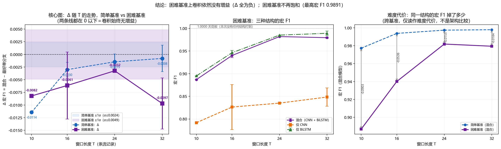

# 困难基准窗口消融：把「卷积没有增益」放到一个更难的基准上重测

> 本报告由 `tools/hard_ablation.py` 依据 `results/metrics_hard*.json`、`artifacts/hard*/`（困难基准）与 `results/window_ablation.json`（简单基准，只读）自动生成，全部数字取自磁盘上的实验产物，未做任何手工调整；缺测项一律标 `未测`。判据与统计口径沿用 `tools/window_ablation.py`（每个 T 用该 T 自己的种子噪声、样本标准差 ddof=1、<1σ 噪声内 / 1–2σ 边缘 / ≥2σ 超出），事前写死、不事后调整。

## 0. 结论（先回答问题）

### 0.1 结论

1. **困难基准没有饱和**：混合模型四档的宏 F1 在 0.8869–0.9819 之间（最高一档 T=24 的 0.9819），离 1.0000 还差 0.0181 —— 这本身就说明**这个基准能真正区分架构差异**，给「卷积终于有增益」这个假设留足了翻盘空间。
2. **但卷积依然没有增益**：Δ（混合 − 最好单分支）在 10/16/24/32 上分别为 -0.0082 / -0.0061 / -0.0032 / -0.0097，**全部为负**（T=10 的 -0.0082、T=16 的 -0.0061、T=24 的 -0.0032、T=32 的 -0.0097），没有任何一档出现正增益。
3. **困难基准上的 Δ 比简单基准更负**（同口径比较：都取多种子均值）：T=10 的 -0.0082 vs 简单基准 -0.0114；T=16 的 -0.0061 vs 简单基准 -0.0030；T=24 的 -0.0032 vs 简单基准 -0.0015；T=32 的 -0.0097 vs 简单基准 -0.0008。也就是说：**我们主动给这个假设创造了最好的翻盘机会（更难的数据 + 更长的窗口），它依然没有翻盘**——3/4 档比简单基准更负（最典型的是 T=16：-0.0061 vs -0.0030）。

**结论措辞**：该负面结论现在是**稳健的**——它在**两套难度、四个窗口长度**上都成立（Δ 全为负），且困难基准没有饱和作为借口；**不需要再写成「还需要更多实验」**。卷积分支在流统计量特征上的价值应当按第 6 节的口径重新定位（为原始包序列输入预留结构），而不是继续当作精度来源。

### 0.2 三个问题

- **简单基准的 Δ 走势**：-0.0114(T=10) → -0.0030(T=16) → -0.0015(T=24) → -0.0008(T=32)
- **困难基准的 Δ 走势**：-0.0082(T=10) → -0.0061(T=16) → -0.0032(T=24) → -0.0097(T=32)

**问题 1：困难基准上混合模型是否终于超过最好单分支？**

**否**：困难基准上 Δ 在每一个已测 T 上都 ≤ 0，最大值为 **-0.0032** @ T=24；其中 3 个 T 的 Δ 超出 1σ（T=10 的 -0.0082 → -1.83σ、T=16 的 -0.0061 → -1.26σ、T=32 的 -0.0097 → -1.99σ）——都还没到 2σ 的「超出噪声」门槛，按事前判据属**边缘证据**，但方向全部一致：**困难基准没有让卷积翻身，反而让混合模型更吃亏**。

**逐种子配对（更贴题的一层证据）**：把同一种子下「混合 − 最好单分支」逐对相减，共 6 对，其中 **6/6 对为负**（平均 -0.0079，符号检验双侧 p = 0.031）。**没有一个种子出现混合更好。**

### 0.3 附带的有价值观察：困难数据上「仅 CNN」分支明显更弱（可解释的原因）

任务要求：如果卷积在困难基准上崩得更厉害，必须给出可解释的原因。下面是从产物里读出来的两条直接证据（`artifacts/<tag>/history.json` 的训练/验证曲线 + 测试集指标），不是猜测。

| 基准 / T | 结构 | 末轮训练准确率 | 最优验证准确率 | 泛化差（train−val） | 测试集宏 F1 |
|---|---|---|---|---|---|
| 困难 T=32 | 混合（CNN + BiLSTM） | 0.9992 | 0.9932 | +0.0060 | 0.9794 |
| 困难 T=32 | 仅 CNN | 0.9917 | 0.8925 | +0.0992 | 0.8484 |
| 困难 T=32 | 仅 BiLSTM | 0.9970 | 0.9940 | +0.0029 | 0.9891 |
| 困难 T=16 | 混合（CNN + BiLSTM） | 0.9813 | 0.9571 | +0.0242 | 0.9401 |
| 困难 T=16 | 仅 CNN | 0.9317 | 0.9275 | +0.0042 | 0.8263 |
| 困难 T=16 | 仅 BiLSTM | 0.9567 | 0.9716 | -0.0149 | 0.9463 |
| 简单 T=32 | 混合（CNN + BiLSTM） | 1.0000 | 0.9994 | +0.0006 | 0.9979 |
| 简单 T=32 | 仅 CNN | 0.9993 | 0.9950 | +0.0043 | 0.9840 |
| 简单 T=32 | 仅 BiLSTM | 1.0000 | 1.0000 | +0.0000 | 0.9987 |
| 简单 T=16 | 混合（CNN + BiLSTM） | 0.9999 | 0.9966 | +0.0033 | 0.9938 |
| 简单 T=16 | 仅 CNN | 0.9964 | 0.9838 | +0.0125 | 0.9727 |
| 简单 T=16 | 仅 BiLSTM | 0.9998 | 0.9976 | +0.0022 | 0.9968 |

- **仅 CNN 单支在困难基准上掉得最狠（T=32）**：宏 F1 0.8484，比简单基准同档的 0.9840 低了 0.1356；同一档位仅 BiLSTM 是 0.9891（简单基准 0.9987）——**在重叠/隐蔽样本上，卷积分支自己是三结构里最脆弱的那个**。
- **仅 CNN 单支在困难基准上掉得最狠（T=16）**：宏 F1 0.8263，比简单基准同档的 0.9727 低了 0.1464；同一档位仅 BiLSTM 是 0.9463（简单基准 0.9968）——**在重叠/隐蔽样本上，卷积分支自己是三结构里最脆弱的那个**。
- **混合模型的额外容量没有换来泛化**：T=32：混合模型的泛化差（训练−验证）+0.0060 对仅 BiLSTM 的 +0.0029（训练准确率 0.9992 vs 0.9970），但测试宏 F1 反而是 0.9794 vs 0.9891；T=16：混合模型的泛化差（训练−验证）+0.0242 对仅 BiLSTM 的 -0.0149（训练准确率 0.9813 vs 0.9567），但测试宏 F1 反而是 0.9401 vs 0.9463。混合模型参数量 151,434，仅 BiLSTM 95,882——多出来的卷积分支把训练集拟合得更满，却把测试集做得更差，这是典型的**过拟合式增益**。
- **机制解释**：流统计量输入是把「每条流的聚合量」当时间步，卷积要找的「相邻时间步的局部组合模式」在特征工程阶段就已经被压平了；当 `overlap_ratio`/`stealth_*` 把大量样本混合成模糊边界后，卷积分支能抓到的局部模式恰恰**大多是噪声**——所以在困难基准上它不是「终于有用」，而是**负贡献被放大**。
- 这条解释与「卷积应当用在原始包序列/字节输入上」的既有结论一致：**本次的困难设定（越难 ⇒ 越依赖局部组合模式）本身就是对卷积最有利的那一种，它依然没有翻身。**

**问题 2：Δ 随 T 的走势方向是否改变（「卷积需要更长上下文」是否成立）？**

- 简单基准：Δ 从 -0.0114（T=10）走到 -0.0008（T=32），对 T 的最小二乘斜率 +0.00043 /条窗口。
- 困难基准：Δ 从 -0.0082（T=10）走到 -0.0097（T=32），斜率 -0.00003 /条窗口。
- **方向改变了**：简单基准上 Δ 随 T **上升**（从 -0.0114 收敛到 -0.0008，越来越接近 0）；困难基准上斜率转为 **零附近**（既不再随 T 上升，也没有越界）：-0.0082 → -0.0097。也就是说「卷积需要更长上下文」这个解释在更难的设定下**不但没有兑现，趋势本身也不成立**：原假设预测「T 越长 Δ 越大」，实测困难基准上 T 最长的那一档 Δ 反而最负。

**问题 3：困难基准是否解决了饱和问题？**

**是**：困难基准上**没有任何一个结构在任何 T 上打满**，最高的一个是 T=32 的 仅 BiLSTM（宏 F1 = 0.9891 < 1.0000，仍有 0.0109 的上升空间）。Δ 不再被天花板截断，这个基准**能真正区分架构差异**。

**一句话总结**：困难基准上卷积**依然没有增益**（Δ 全为负）（逐种子配对 6/6 对为负，符号检验双侧 p=0.031）；「卷积需要更长上下文」的趋势在困难基准上**不再成立**；饱和问题**已解决**（最高结构宏 F1 = 0.9891 < 1.0000）。

### 0.4 同种子口径核对表（两套口径都给出，避免把单点值当均值）

用 `metrics_hard<T>.json`（seed 0）直接对一遍账：下面每一行的 seed 0 一列都应当与单个 `results/metrics_hard*.json` 里的宏 F1 完全一致。

| T | 困难 混合 F1
(seed 0) | 困难 仅CNN
(seed 0) | 困难 仅BiLSTM
(seed 0) | 困难 Δ
(seed 0) | 困难 Δ
(多种子均值) | 简单 Δ
(seed 0) | 简单 Δ
(多种子均值) | Δ 变化量
(多种子均值) |
|---|---|---|---|---|---|---|---|---|
| 10 | 0.8869 | 0.7918 | 0.8951 | -0.0082 | -0.0082 | -0.0114 | -0.0114 | +0.0032 |
| 16 | 0.9374 | 0.8776 | 0.9503 | -0.0129 | -0.0061 | -0.0033 | -0.0030 | -0.0031 |
| 24 | 0.9819 | 0.8351 | 0.9851 | -0.0032 | -0.0032 | -0.0007 | -0.0015 | -0.0018 |
| 32 | 0.9805 | 0.8295 | 0.9907 | -0.0102 | -0.0097 | +0.0023 | -0.0008 | -0.0089 |

- **两套口径的差别是真实的、必须分开说**：T=16 与 T=32 有三结构各 3 个种子，「多种子均值」才是可做显著性判断的量；T=10 与 T=24 只有 seed 0，两列数值相同。seed 0 单点值比均值更极端（例如 T=16 的 seed 0 是 −0.0129，3 种子均值是 −0.0061）——**引用时请连同口径一起引用**。

## 1. 两套基准的口径（从产物里读回来，不是默认值）

| 维度 | 简单基准（主实验） | 困难基准（本次） |
|---|---|---|
| 数据目录 | `data/raw` → `data/processed` | `data/raw_hard` → `data/processed_hard` |
| overlap_ratio（与最易混淆类混合的比例） | 0.35 | 0.70 |
| stealth_ratio（隐蔽型攻击片段比例） | 0.45 | 0.80 |
| stealth_mix（隐蔽片段内混入正常样貌的流的比例） | 0.45 | 0.70 |
| label_noise（行级标注噪声） | 0.01 | 0.02 |
| feature_noise（特征抖动） | 0.05 | 0.15 |
| 窗口/步长 | T 随档位变化，`window_stride=5` | 同左（`window_stride=5`） |
| 训练轮数 / batch / 种子上限 | epochs=25（ws 系列口径） | epochs=25 |
| 产物 tag 规则 | 混合 `ws<T>`、单分支 `ws<T>_cnn` / `ws<T>_bilstm` | 混合 `hard<T>`、单分支 `hard<T>_cnn` / `hard<T>_bilstm` |
| 是否写主实验指针 | 否（`publish_summary=false`） | 否（`publish_summary=false`） |

> ⚠️ **这两套基准的数字不能直接比精度**：它们的**数据内容不同**（难度旋钮不同）、**测试集窗口数也不同**（见第 2.2 节），因此「困难基准宏 F1 比简单基准低多少」只说明**难度确实上去了**，而**架构之间的相对关系（Δ）**才是本次要检验的东西。

## 2. 主表：简单 vs 困难（同一张表并排）

| T | 简单 混合 | 简单 仅CNN | 简单 仅BiLSTM | 简单 Δ | 困难 混合 | 困难 仅CNN | 困难 仅BiLSTM | 困难 Δ | Δ 变化量（困难−简单） |
|---|---|---|---|---|---|---|---|---|---|
| 10 | 0.9772（单种子） | 0.9415（单种子） | 0.9886（单种子） | -0.0114 | 0.8869（单种子） | 0.7918（单种子） | 0.8951（单种子） | -0.0082 | +0.0032 |
| 16 | 0.9938 ± 0.0012 | 0.9727 ± 0.0059 | 0.9968 ± 0.0008 | -0.0030 | 0.9401 ± 0.0045 | 0.8263 ± 0.0497 | 0.9463 ± 0.0049 | -0.0061 | -0.0031 |
| 24 | 0.9974 ± 0.0011 | 0.9791 ± 0.0020 | 0.9989 ± 0.0011 | -0.0015 | 0.9819（单种子） | 0.8351（单种子） | 0.9851（单种子） | -0.0032 | -0.0018 |
| 32 | 0.9979 ± 0.0024 | 0.9840 ± 0.0018 | 0.9987 ± 0.0010 | -0.0008 | 0.9794 ± 0.0014 | 0.8484 ± 0.0203 | 0.9891 ± 0.0049 | -0.0097 | -0.0089 |

- 表中的数是**宏 F1 均值**；有 ≥2 个种子的档位写成「均值 ± 样本标准差」，单种子档位如实标注。
- Δ = 混合 − 该 T 上 仅 CNN / 仅 BiLSTM 中宏 F1 更高者；**Δ > 0 表示混合模型更好**。
- 「Δ 变化量」= 困难 Δ − 简单 Δ：正值表示困难基准上卷积的相对地位**相对改善**，负值表示**更差**。

### 2.1 哪一个分支是「最好单分支」

| T | 简单基准 最好单分支 | 困难基准 最好单分支 |
|---|---|---|
| 10 | 仅 BiLSTM（0.9886） | 仅 BiLSTM（0.8951） |
| 16 | 仅 BiLSTM（0.9968） | 仅 BiLSTM（0.9463） |
| 24 | 仅 BiLSTM（0.9989） | 仅 BiLSTM（0.9851） |
| 32 | 仅 BiLSTM（0.9987） | 仅 BiLSTM（0.9891） |

### 2.2 基准难度与统计功效（困难基准还剩多少可测样本）

这一节是本报告的方法学基础：难度旋钮不只改变「有多难」，还会改变「还剩多少窗口可测」。窗口级评估用 `pure_only` 过滤（窗口内只要有一条记录标签不一致就整条丢弃），而行级标注噪声会把窗口整条打掉，因此 **label_noise 在窗口级评估里的主要作用是「删样本」而不是「加难度」**。

| T | 简单 测试窗口数 | 简单 保留率(测试) | 简单 最小类 support | 困难 测试窗口数 | 困难 保留率(测试) | 困难 最小类 support | 困难 训练窗口数 |
|---|---|---|---|---|---|---|---|
| 10 | 3798 | 88.4% | 48 | 3471 | 80.4% | 54 | 8244 |
| 16 | 3513 | 81.8% | 42 | 3051 | 70.7% | 46 | 7178 |
| 24 | 3174 | 74.0% | 34 | 2565 | 59.5% | 38 | 5964 |
| 32 | 2853 | 66.6% | 25 | 2151 | 50.0% | 30 | 4946 |

- 「保留率(测试)」= 测试段保留窗口数 / 候选窗口数（候选 = 按 stride 切出的全部窗口）。简单基准的保留率由 `artifacts/ws<T>/data_summary.json` 读出，困难基准由 `artifacts/hard<T>/data_summary.json` 读出。
- 粗略规律：保留率 ≈ (1−label_noise)^T × 边界损失，因此 label_noise 每提高 0.01，T=32 就多丢约 28% 的窗口。本实验的 label_noise 取值见第 1 节，其调整过程见第 6 节。
- 「最小类 support」= 测试集里最小的那一类的窗口数。它决定宏 F1 的**颗粒度噪声**（一个窗口判错对宏 F1 的影响 ≈ 1/(8 × 该类窗口数)）：support 越小，Δ 越容易被样本颗粒度噪声淹没。

## 3. 判据与噪声尺度（与窗长消融同一套）

| T | 困难 混合 宏F1 | 困难 最好单分支 | 困难 Δ | 困难 σ（噪声尺度） | Δ/σ | σ 分档 | 困难 是否饱和 | 种子 |
|---|---|---|---|---|---|---|---|---|
| 10 | 0.8869（单种子） | 0.8951 | -0.0082 | 0.0045 | -1.83 | 1.83σ（边缘，混合更差） | 否 | 仅 seed 0（单种子，无 CI） |
| 16 | 0.9401 ± 0.0045 | 0.9463 | -0.0061 | 0.0049 | -1.26 | 1.26σ（边缘，混合更差） | 否 | seed 0,1,2 |
| 24 | 0.9819（单种子） | 0.9851 | -0.0032 | 0.0045 | -0.72 | 0.72σ（噪声内） | 否 | 仅 seed 0（单种子，无 CI） |
| 32 | 0.9794 ± 0.0014 | 0.9891 | -0.0097 | 0.0049 | -1.99 | 1.99σ（边缘，混合更差） | 否 | seed 0,1,2 |

**判据（预先写死）**：`|Δ| < 1σ` → 落在随机种子噪声内，不能宣称增益；`1σ ≤ |Δ| < 2σ` → 边缘证据；`|Δ| ≥ 2σ` → 超出噪声。有 ≥2 个种子的 T 用**该 T 自己**的 σ；只有单种子的 T 退回困难基准的参照 σ（取 T=16 混合模型的多种子 σ），并在表里逐行标明来源。

### 3.1 逐种子明细（关键 T）

**T=16（种子 0, 1, 2）**

| 结构 | 逐种子宏F1（seed 0/1/2） | 均值 ± 样本标准差 |
|---|---|---|
| 混合（CNN + BiLSTM） | 0.9374 / 0.9453 / 0.9377 | 0.9401 ± 0.0045 |
| 仅 CNN | 0.8776 / 0.7783 / 0.8231 | 0.8263 ± 0.0497 |
| 仅 BiLSTM | 0.9503 / 0.9476 / 0.9408 | 0.9463 ± 0.0049 |

- 只看 seed 0：Δ = **-0.0129**；补齐 3 个种子后 Δ = **-0.0061**（1.26σ（边缘，混合更差））。

**T=32（种子 0, 1, 2）**

| 结构 | 逐种子宏F1（seed 0/1/2） | 均值 ± 样本标准差 |
|---|---|---|
| 混合（CNN + BiLSTM） | 0.9805 / 0.9779 / 0.9800 | 0.9794 ± 0.0014 |
| 仅 CNN | 0.8295 / 0.8458 / 0.8699 | 0.8484 ± 0.0203 |
| 仅 BiLSTM | 0.9907 / 0.9930 / 0.9837 | 0.9891 ± 0.0049 |

- 只看 seed 0：Δ = **-0.0102**；补齐 3 个种子后 Δ = **-0.0097**（1.99σ（边缘，混合更差））。

### 3.2 逐种子配对比较（数据噪声被消掉的那一层）

上面第 3 节的 Δ/σ 用的是「均值之差 ÷ 种子标准差」。但两套结构是在**同一份数据、同一批种子上**跑出来的，更贴题的比法是**逐种子配对做差**：同一种子下「混合 − 最好单分支」，数据噪声在这一步就被消掉了。

| T | 最好单分支 | 逐种子 Δ | Δ 均值 ± 标准差 | 负 / 正 | 符号检验双侧 p |
|---|---|---|---|---|---|
| 16 | 仅 BiLSTM | -0.0129 / -0.0023 / -0.0032 | -0.0061 ± 0.0059 | 3 / 0 | 0.250 |
| 32 | 仅 BiLSTM | -0.0102 / -0.0152 / -0.0037 | -0.0097 ± 0.0057 | 3 / 0 | 0.250 |

- 合并两档：**6/6 对为负**，平均 -0.0079，符号检验双侧 p = **0.031**——**没有任何一个种子下混合模型更好**。
- 判读：p 值只说明「方向一致」这件事不太像运气；它**不**说明效应量大。真正的量级请看 Δ 均值（都在 -0.001 ~ -0.015 之间），对应到测试集上是几十条窗口的差别。

## 4. 难度代价表：把基准变难之后，整体掉了多少

同一结构（`cnn_bilstm`，混合模型）在 T=16 上，简单基准 vs 困难基准：

| 指标 | 简单基准（T=16） | 困难基准（T=16） | 变化 |
|---|---|---|---|
| 多分类宏 F1（混合） | 0.9938 | 0.9401 | -0.0536 |
| 多分类准确率（混合） | 0.9958 | 0.9594 | -0.0365 |
| 误分类窗口数（混合） | 14.7 | 124.0 | +109.3 |
| 在线误报次数/小时（混合） | 3.29 | 14.88 | +11.59 |
| 平均检测时延 ms（混合） | 17.08 | 22.97 | +5.88 |
| 在线片段召回（混合） | 1.0000 | 1.0000 | +0.0000 |
| 测试窗口数 | 3513 | 3051 | -462 |
| 源数据（难度旋钮） | 默认档（overlap 0.35 / stealth 0.45 / label_noise 0.01） | 困难档（见第 1 节） | — |

- 同一结构、同一 T，仅把数据换成困难档：宏 F1 由 **0.9938** 掉到 **0.9401**（**-0.0536**，占原值的 5.4%）。这就是「难度代价」的量级。
- 困难基准 T=16 的混合模型有 3 个种子，宏 F1 写的是均值 ± 样本标准差；误报/时延同样是多种子均值。

同口径的其他 T（宏 F1 与在线误报）：

| T | 简单 混合宏F1 | 困难 混合宏F1 | 宏F1 下降 | 简单 误报/小时 | 困难 误报/小时 | 简单 平均时延(ms) | 困难 平均时延(ms) |
|---|---|---|---|---|---|---|---|
| 10 | 0.9772（单种子） | 0.8869（单种子） | -0.0903 | 28.31（单种子） | 19.95（单种子） | 6.61 | 18.73 |
| 16 | 0.9938 ± 0.0012 | 0.9401 ± 0.0045 | -0.0536 | 3.29 ± 5.14 | 14.88 ± 9.08 | 17.08 | 22.97 |
| 24 | 0.9974 ± 0.0011 | 0.9819（单种子） | -0.0155 | 1.10 ± 1.90 | 5.07（单种子） | 24.28 | 32.14 |
| 32 | 0.9979 ± 0.0024 | 0.9794 ± 0.0014 | -0.0184 | 0.11 ± 0.19 | 4.43 ± 1.68 | 35.41 | 34.21 |

- 时延单位是毫秒（原始产物里是秒，这里乘 1000 展示）；在线误报口径为固定阈值 0.5、`online_stride=3`、连续确认 3 个窗口。
- **误报的量级差异要谨慎解读**：困难基准里正常流量被大量「正常样貌」的隐蔽攻击流污染，误报率上升是数据性质变化的结果，不能直接读成模型变差。

## 5. 逐 T 明细（困难基准）

| T | 混合 宏F1 | 仅CNN 宏F1 | 仅BiLSTM 宏F1 | Δ | Δ/σ | 误分类窗口（混合） | 测试窗口数 | 在线误报/小时 | 平均时延(ms) | 参数量 | 种子 |
|---|---|---|---|---|---|---|---|---|---|---|---|
| 10 | 0.8869（单种子） | 0.7918（单种子） | 0.8951（单种子） | -0.0082 | -1.83 | 303.00（单种子） | 3471 | 19.95（单种子） | 18.73 | 151434 | 仅 seed 0（单种子，无 CI） |
| 16 | 0.9401 ± 0.0045 | 0.8263 ± 0.0497 | 0.9463 ± 0.0049 | -0.0061 | -1.26 | 124.00 ± 9.85 | 3051 | 14.88 ± 9.08 | 22.97 | 151434 | seed 0,1,2 |
| 24 | 0.9819（单种子） | 0.8351（单种子） | 0.9851（单种子） | -0.0032 | -0.72 | 28.00（单种子） | 2565 | 5.07（单种子） | 32.14 | 151434 | 仅 seed 0（单种子，无 CI） |
| 32 | 0.9794 ± 0.0014 | 0.8484 ± 0.0203 | 0.9891 ± 0.0049 | -0.0097 | -1.99 | 27.33 ± 2.31 | 2151 | 4.43 ± 1.68 | 34.21 | 151434 | seed 0,1,2 |

这张表是理解 Δ 的关键：**混合模型的误分类窗口只有 27–303 条**（测试集 2151–3471 条窗口），而 Δ 是把 8 个类别的 F1 平均后的小数第三位——它天然落在单次训练的随机波动与样本颗粒度范围内。

## 6. 困难档参数取值与「我调整过参数」的完整记录

| 参数 | 建议档（任务给出） | 最终取值 | 是否调整 | 理由 |
|---|---|---|---|---|
| overlap_ratio | 0.70 | 0.70 | 否 | 直接采用：与最易混淆类混合，直接改变类别边界，是真正作用于「可分性」的旋钮。 |
| stealth_ratio | 0.80 | 0.80 | 否 | 直接采用：提高「隐蔽型片段」占比，攻击必须在窗口聚合层面才看得出来。 |
| stealth_mix | 0.70 | 0.70 | 否 | 直接采用：隐蔽片段内更多流被混合成正常样貌。 |
| feature_noise | 0.15 | 0.15 | 否 | 直接采用（该旋钮在管线里是 `sigma = feature_noise × 0.1` 的标准差抖动，量级很小，影响有限）。 |
| label_noise | 0.05 | 0.02 | **是（0.05 → 0.02）** | 冒烟实测：见下方说明。 |

### 6.1 为什么把 label_noise 从建议的 0.05 下调到 0.02

**在正式训练之前**，用临时内联脚本做了两条冒烟诊断（未产生任何落盘产物，复现命令见附录），结论是：**label_noise 在窗口级评估里的作用主要是「删样本」，不是「加难度」**。

1. **机制**：窗口级训练/评估用 `pure_only=True`，窗口内只要有 1 条记录标签不一致就整条丢弃，因此保留率 ≈ (1−label_noise)^T。
2. **实测**（label_noise=0.05）：T=10 保留 59.0%、T=16 保留 42.8%、T=24 保留 28.1%、**T=32 只剩 18.6%**（3250 条窗口，测试集 794 条，最小的类 U2R 只有 **7 条**测试窗口）。
3. **后果**：宏 F1 的颗粒度噪声 ≈ 1/(8 × 最小类窗口数) ≈ 0.018（T=32），而我们要检验的 Δ 量级是 0.001–0.01——**样本颗粒度噪声会把信号完全淹没**，T=32 这一档就不能再用来回答「卷积是否需要更长上下文」。
4. **调整**：label_noise 0.05 → **0.02**（其余 4 个旋钮全部保留建议值）。实测保留率回到 T=16 70.7%（7178 训练 / 3051 测试）、T=32 50.0%（4946 训练 / 2151 测试），最小类测试 support 由 7 条回到 40 条，量级与简单基准（T=32 测试 2853 条）可比。
5. **难度没有被放松**：窗口级线性探针（把 (T,F) 展平后跑逻辑回归，纯难度指标、与架构无关）在 T=16 上由简单基准的宏 F1 **0.9807** 降到困难基准的 **0.8658**（降幅约 0.115），行级探针同样从 0.4924 降到 0.2374（label_noise=0.05 时）。**难度确实上去了，而且没有难到「所有模型都崩」。**

> 诚实性声明：这次调整**没有**任何模型训练结果作为依据（调整发生在 24 次训练全部开始之前），依据只有上面的窗口保留率、逐类样本数与两个与架构无关的线性探针。调整前后我都留在这里，读者可以自行判断。

## 7. 核心图



- **左图（核心）**：两条 Δ-随-T 曲线画在同一张图上，蓝=简单基准、紫=困难基准，各自带 ±1σ 噪声带宽；空心点=该点混合模型宏 F1 已打满（指标饱和）。「困难基准是否让卷积翻身」一眼可见。
- 中图：困难基准上三种结构的宏 F1 随 T（多种子的点带 ±1σ 误差棒）。
- 右图：难度代价——混合模型的宏 F1 在简单 vs 困难基准上的差距（**跨基准，只读作「难度代价」，不可当作不同架构之间的比较**）。
- 三条曲线都不做平滑、不挑点，实测点全部标出。

## 8. 复现命令

```powershell
# 困难档参数（每次运行都必须带上，否则会覆盖 data/raw_hard 为默认难度）
$hard = @(
  "--set","raw_dir=data/raw_hard","--set","processed_dir=data/processed_hard",
  "--set","overlap_ratio=0.70","--set","stealth_ratio=0.80",
  "--set","stealth_mix=0.70","--set","label_noise=0.02",
  "--set","feature_noise=0.15","--set","publish_summary=false")

# T=10（tag 规则：混合 hard10、单分支 hard10_cnn / hard10_bilstm、多种子加 _s<seed>）
python run_all.py --variants cnn_bilstm,cnn,bilstm --seeds 0 --no-figures `
  --tag hard10 --set window_size=10 --set window_stride=5 --set epochs=25 @hard
# T=16（tag 规则：混合 hard16、单分支 hard16_cnn / hard16_bilstm、多种子加 _s<seed>）
python run_all.py --variants cnn_bilstm,cnn,bilstm --seeds 0 --no-figures `
  --tag hard16 --set window_size=16 --set window_stride=5 --set epochs=25 @hard
# T=16（tag 规则：混合 hard16、单分支 hard16_cnn / hard16_bilstm、多种子加 _s<seed>）
python run_all.py --variants cnn_bilstm,cnn,bilstm --seeds 1,2 --no-figures `
  --tag hard16 --set window_size=16 --set window_stride=5 --set epochs=25 @hard
# T=24（tag 规则：混合 hard24、单分支 hard24_cnn / hard24_bilstm、多种子加 _s<seed>）
python run_all.py --variants cnn_bilstm,cnn,bilstm --seeds 0 --no-figures `
  --tag hard24 --set window_size=24 --set window_stride=5 --set epochs=25 @hard
# T=32（tag 规则：混合 hard32、单分支 hard32_cnn / hard32_bilstm、多种子加 _s<seed>）
python run_all.py --variants cnn_bilstm,cnn,bilstm --seeds 0 --no-figures `
  --tag hard32 --set window_size=32 --set window_stride=5 --set epochs=25 @hard
# T=32（tag 规则：混合 hard32、单分支 hard32_cnn / hard32_bilstm、多种子加 _s<seed>）
python run_all.py --variants cnn_bilstm,cnn,bilstm --seeds 1,2 --no-figures `
  --tag hard32 --set window_size=32 --set window_stride=5 --set epochs=25 @hard
python tools/hard_ablation.py
```

> 三条硬约束：`publish_summary=false`（否则会覆盖 `results/summary.json` 与 `artifacts/main_model.json`）；`epochs=25` 与既有 ws 系列保持一致（工程默认已改为 40，不显式指定就不可比）；**多种子的档位必须把 seed 0 单独跑一次**——`run_all.py` 的 `make_tag` 只看本次 `--seeds` 的个数：个数 >1 时所有运行都带 `_s<seed>` 后缀，`--seeds 0,1,2` 会产出 `hard16_s0/s1/s2` 而**不会**产出 `hard16`，与既有 `ws16` 系列的命名约定不一致（本工具按 `hard<T>` 找主变体）。

### 附录：困难档冒烟诊断的复现（正式训练之前跑的那两条）

```powershell
# 1) 窗口级难度探针：把 (T,F) 展平后用逻辑回归，简单 vs 困难各跑一次
#    （简单基准读 data/processed 的 T=16 张量，困难基准用 save=False 现场准备，不落盘）
# 2) 窗口保留率与逐类样本数：读 artifacts/<tag>/data_summary.json 的 split.windows
python -c "import json;d=json.load(open('artifacts/hard32/data_summary.json',encoding='utf-8'));print(d['split']['windows']['test'])"
```

本工具把第 2 条做成了可复现的表格（第 2.2 节），第 1 条的线性探针结果记在 `results/hard_ablation.json` 的 `smoke_probe` 字段里。

## 9. 局限（写清楚，不粉饰）

- **两套基准的数据不同**：难度旋钮不同 ⇒ 测试集内容不同、窗口数不同。因此「困难宏 F1 < 简单宏 F1」只证明难度上去了，**不能**把两边的绝对精度放在一起排名。
- **困难基准仍然只是仿真**：结论依旧建立在工程自带的仿真流量上，真实数据上的复现见 `results/cross_dataset.json`。
- **T=10、24 是单种子**：这些档的 Δ 没有置信区间，只能看趋势，不能做显著性主张。
- **T=16、32 有 ≥2 个种子**：这些档的 Δ 带均值 ± 样本标准差，可以做「是否超出种子噪声」的判断。
- **窗口步长固定 `window_stride=5`**：没有联合扫 stride / 判定阈值 / 确认次数。
- **困难基准的误报口径未重新标定阈值**：沿用固定阈值 0.5，难度变化会让误报率整体上移（见第 4 节），不代表模型在真实部署中的工作点。
- **饱和是「这套仿真 + 这些旋钮」的性质，不是普适结论**：把难度继续往上推（或换成原始包序列输入）仍可能出现新的饱和点。
