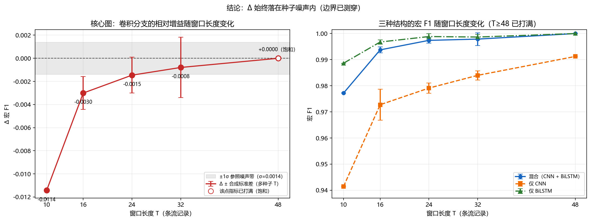

# 窗口长度消融：卷积分支在流统计量特征上到底有没有增益

> 本报告由 `tools/window_ablation.py` 依据 `results/metrics_ws*.json` 与 `artifacts/ws*/config_used.json` 自动生成，全部数字取自磁盘上的实验产物，未做任何手工调整；缺测项一律标 `未测`。判定阈值在脚本里预先写死，不做事后调整。

## 0. 结论（先说硬的）

**差距走势**：-0.0114(T=10) → -0.0030(T=16) → -0.0015(T=24) → -0.0008(T=32) → +0.0000(T=48)；T=48 处双方都饱和到 1.0。

**假设②成立：边界已测穿。在流统计量特征上，卷积分支是冗余的。**

### 0.1 补齐种子后发生了什么（本轮关键）

同一种配置只跑 1 个种子时，Δ 的符号可能完全由那一次运行决定。下面把每个有 ≥2 个种子的 T 的**逐种子结果**摊开，这是判断「某个 Δ 是真实增益还是运气」的唯一直接证据：

**T=16（种子 0, 1, 2）**

| 结构 | 逐种子宏F1（seed 0/1/2） | 均值 ± 样本标准差 |
|---|---|---|
| 混合（CNN + BiLSTM） | 0.9940 / 0.9925 / 0.9948 | 0.9938 ± 0.0012 |
| 仅 CNN | 0.9670 / 0.9788 / 0.9725 | 0.9727 ± 0.0059 |
| 仅 BiLSTM | 0.9973 / 0.9971 / 0.9958 | 0.9968 ± 0.0008 |

- **只看 seed 0**：Δ = 0.9940 − 0.9973 = **-0.0033**；**补齐 3 个种子后**：Δ = -0.0030（判据用该 T 自己的 σ=0.0012，落在 **2.55σ（超出，混合更差）**）。

**T=24（种子 0, 1, 2）**

| 结构 | 逐种子宏F1（seed 0/1/2） | 均值 ± 样本标准差 |
|---|---|---|
| 混合（CNN + BiLSTM） | 0.9970 / 0.9966 / 0.9986 | 0.9974 ± 0.0011 |
| 仅 CNN | 0.9813 / 0.9776 / 0.9784 | 0.9791 ± 0.0020 |
| 仅 BiLSTM | 0.9977 / 0.9988 / 1.0000 | 0.9989 ± 0.0011 |

- **只看 seed 0**：Δ = 0.9970 − 0.9977 = **-0.0007**；**补齐 3 个种子后**：Δ = -0.0015（判据用该 T 自己的 σ=0.0011，落在 **1.28σ（边缘，混合更差）**）。

**T=32（种子 0, 1, 2）**

| 结构 | 逐种子宏F1（seed 0/1/2） | 均值 ± 样本标准差 |
|---|---|---|
| 混合（CNN + BiLSTM） | 1.0000 / 0.9952 / 0.9984 | 0.9979 ± 0.0024 |
| 仅 CNN | 0.9846 / 0.9820 / 0.9854 | 0.9840 ± 0.0018 |
| 仅 BiLSTM | 0.9977 / 0.9987 / 0.9996 | 0.9987 ± 0.0010 |

- **只看 seed 0**：Δ = 1.0000 − 0.9977 = **+0.0023**；**补齐 3 个种子后**：Δ = -0.0008（判据用该 T 自己的 σ=0.0024，落在 **0.33σ（噪声内）**）。
- 那个正向迹象**完全来自 seed 0 这一次运行**：它是 3 个种子里表现最好的那一次，多种子平均后 Δ 转负。**单种子时它的符号没有任何保证。**
- **因此：单种子时看到的 +0.0023 不构成对「卷积分支需要更长上下文」的支持；补齐种子后 Δ 转负并落入噪声内，该假设在窗口长度这个维度上没有得到任何可用证据。**

### 0.2 这次结论反转本身值得记录（方法学）

- 单种子（seed 0）在 **T=32** 上得到 Δ = **+0.0023**，看上去像「卷积终于有增益了」——如果报告停在这一步，我们会写下一个**假阳性**。
- 补齐其余种子后（共 3 个）Δ 变成 **-0.0008**，**落在该 T 的种子标准差（σ=0.0024）之内**——正向迹象消失。
- 原因很直白：seed 0 恰好是 3 个种子里表现最好的那一次，其余种子都没有它好（见 §0.1 的逐种子表）。
- 因此 **「单种子 + 边缘显著」这个组合本身就不可作为结论**：它既可能来自真实效应，也可能来自一次运气好的初始化与训练顺序，而**单次运行无法区分这两者**。
- 这正是本工程坚持「每个配置跑 3 个随机种子、报均值 ± 样本标准差」的原因；本报告第 3 节把判据写成 σ 分档（<1σ 噪声内 / 1–2σ 边缘 / ≥2σ 超出），也是为了让「差多少才算差」在事前就有据可依，而不是事后挑标准。
- 一句话总结：**我们自己抓到了自己的一个假阳性，并把修正过程留在报告里**——一个能被自己的补充实验推翻的数字，比一个漂亮但站不住的正向数字更有价值。

**这一轮真正可用的收获是部署结论**：误报最低且**有置信区间**的是 **T=32**（0.11 ± 0.19 次/小时，宏 F1 0.9979 ± 0.0024），代价是平均检测时延 **35.4 ms**。即使取 3 个种子里最差的那次（0.33 次/小时），也在同一量级——说明这个误报优势不是挑种子挑出来的。对照 T=16：误报 3.29 次/小时、时延 17.1 ms。即用约 18 ms 的额外时延换掉约 30 倍的误报。**若业务能接受约 35 ms 的检测时延，T=32 是比 T=16 更好的工作点**（不动阈值、不动模型，纯靠输入形状换误报）；若时延预算只有十几毫秒，就该留在 T=16，改用阈值标定/连续确认来压误报。另外 T=48 的单次观测误报更低（0.00 次/小时），但它只有 1 个种子、没有置信区间，**不建议仅凭它选型**。

## 1. 实验口径（从产物里读回来，不是默认值）

| T | window_size | window_stride | online_stride | epochs | batch | purge_windows | 该 T 的种子 |
|---|---|---|---|---|---|---|---|
| 10 | 10 | 5 | 3 | 25 | 256 | 2 | 仅 seed 0（单种子，无 CI） |
| 16 | 16 | 5 | 3 | 25 | 256 | 2 | seed 0,1,2 |
| 24 | 24 | 5 | 3 | 25 | 256 | 2 | seed 0,1,2 |
| 32 | 32 | 5 | 3 | 25 | 256 | 2 | seed 0,1,2 |
| 48 | 48 | 5 | 3 | 25 | 256 | 2 | 仅 seed 0（单种子，无 CI） |

- 产物命名规则（与 `run_all.py` 的 `make_tag` 一致）：混合模型 `ws<T>`、单分支 `ws<T>_cnn` / `ws<T>_bilstm`，多种子再加 `_s<seed>`；指标文件即 `results/metrics_<tag>.json`。
- 所有 T 共用同一份合成数据（数据生成固定用 cfg.seed，与训练种子无关），同一 T 下的多个种子**只有模型随机种子不同、数据完全相同**——这正是估算种子噪声所需的对照。
- 全部运行都带 `--set publish_summary=false`，因此**不会写主实验指针**（`results/summary.json` 与 `artifacts/main_model.json` 保持原样）。

## 2. 主表：三种结构 × 窗口长度（多种子给均值 ± 样本标准差）

| T | 混合 宏F1 | 仅 CNN 宏F1 | 仅 BiLSTM 宏F1 | 混合 − 最好单分支 | 误报/小时（混合） | 平均检测时延(ms)（混合） | 单窗口推理(ms) | 种子 |
|---|---|---|---|---|---|---|---|---|
| 10 | 0.9772（单种子） | 0.9415（单种子） | 0.9886（单种子） | -0.0114 | 28.31（单种子） | 6.61 | 未测 | 仅 seed 0（单种子，无 CI） |
| 16 | 0.9938 ± 0.0012 | 0.9727 ± 0.0059 | 0.9968 ± 0.0008 | -0.0030 | 3.29 ± 5.14 | 17.08 | 49.98 | seed 0,1,2 |
| 24 | 0.9974 ± 0.0011 | 0.9791 ± 0.0020 | 0.9989 ± 0.0011 | -0.0015 | 1.10 ± 1.90 | 24.28 | 未测 | seed 0,1,2 |
| 32 | 0.9979 ± 0.0024 | 0.9840 ± 0.0018 | 0.9987 ± 0.0010 | -0.0008 | 0.11 ± 0.19 | 35.41 | 未测 | seed 0,1,2 |
| 48 | 1.0000（单种子） | 0.9912（单种子） | 1.0000（单种子） | 0.0000 | 0.00（单种子） | 42.09 | 未测 | 仅 seed 0（单种子，无 CI） |

- 「最好单分支」= 该 T 上 仅 CNN 与 仅 BiLSTM 中宏 F1 均值更高者；差值 > 0 表示混合模型更好。
- 单窗口推理耗时来自 `results/benchmark_latency.json`（tag=`cnn_bilstm_main_s0`，入口张量窗口长度 = 16），**只有主模型口径测过**，其余 T 标 `未测`；各批量的每窗口耗时分别为 batch=1 → 49.982 ms / batch=16 → 2.303 ms / batch=64 → 0.610 ms / batch=256 → 0.206 ms。

- T=16 独立复算核对：`run_all.py` 自己写的 `results/aggregate_ws16.json` 只覆盖 `--seeds 1,2` 那两次运行（**不含 seed 0**），把它与本工具对同两个种子的统计对比即可验证口径一致——混合（CNN + BiLSTM） mean=0.9936、std=0.0012、n=2；仅 CNN mean=0.9756、std=0.0032、n=2；仅 BiLSTM mean=0.9965、std=0.0006、n=2。（本报告第 2 节的数是 3 个种子的，因此数值不同是正常的。）

- T=24 独立复算核对：`run_all.py` 自己写的 `results/aggregate_ws24.json` 只覆盖 `--seeds 1,2` 那两次运行（**不含 seed 0**），把它与本工具对同两个种子的统计对比即可验证口径一致——混合（CNN + BiLSTM） mean=0.9976、std=0.0010、n=2；仅 CNN mean=0.9780、std=0.0004、n=2；仅 BiLSTM mean=0.9994、std=0.0006、n=2。（本报告第 2 节的数是 3 个种子的，因此数值不同是正常的。）

- T=32 独立复算核对：`run_all.py` 自己写的 `results/aggregate_ws32.json` 只覆盖 `--seeds 1,2` 那两次运行（**不含 seed 0**），把它与本工具对同两个种子的统计对比即可验证口径一致——混合（CNN + BiLSTM） mean=0.9968、std=0.0016、n=2；仅 CNN mean=0.9837、std=0.0017、n=2；仅 BiLSTM mean=0.9992、std=0.0004、n=2。（本报告第 2 节的数是 3 个种子的，因此数值不同是正常的。）


## 2.1 第二条结论：窗口长度是误报的「免费闸门」，代价是检测时延

| T | 误报/小时（混合） | 误报次数（混合） | 平均检测时延(ms)（混合） | p95 时延(ms)（混合） | 片段召回（混合） |
|---|---|---|---|---|---|
| 10 | 28.31（单种子） | 86.00（单种子） | 6.61 | 25.65 | 1.000（单种子） |
| 16 | 3.29 ± 5.14 | 10.00 ± 15.62 | 17.08 | 63.32 | 1.000 ± 0.000 |
| 24 | 1.10 ± 1.90 | 3.33 ± 5.77 | 24.28 | 92.13 | 1.000 ± 0.000 |
| 32 | 0.11 ± 0.19 | 0.33 ± 0.58 | 35.41 | 115.89 | 1.000 ± 0.000 |
| 48 | 0.00（单种子） | 0.00（单种子） | 42.09 | 147.46 | 1.000（单种子） |

- 趋势是**单调且方向相反**的：窗口越长，误报越低，但检测时延越高。原因是机械的——窗口越长，单个窗口覆盖流记录越多，随机抖动被平均掉；但一条攻击要在窗口内被确认，就必须等窗口填满，时延随 T 线性增长。
- 结论：**窗口长度是误报的免费闸门**（不动阈值、不动模型，纯靠改输入形状就把误报压下来），**代价是时延**。误报最低且**有置信区间**的是 **T=32**（0.11 ± 0.19 次/小时，宏 F1 0.9979 ± 0.0024），代价是平均检测时延 **35.4 ms**。即使取 3 个种子里最差的那次（0.33 次/小时），也在同一量级——说明这个误报优势不是挑种子挑出来的。对照 T=16：误报 3.29 次/小时、时延 17.1 ms。即用约 18 ms 的额外时延换掉约 30 倍的误报。**若业务能接受约 35 ms 的检测时延，T=32 是比 T=16 更好的工作点**（不动阈值、不动模型，纯靠输入形状换误报）；若时延预算只有十几毫秒，就该留在 T=16，改用阈值标定/连续确认来压误报。另外 T=48 的单次观测误报更低（0.00 次/小时），但它只有 1 个种子、没有置信区间，**不建议仅凭它选型**。

### 2.2 误分类窗口数（宏 F1 差值到底等于多少条窗口）

| T | 测试窗口数 | 混合 误分类 | 最好单分支 误分类 | 误分类之差 |
|---|---|---|---|---|
| 10 | 3798 | 56.00（单种子） | 26.00（单种子） | 30.00 |
| 16 | 3513 | 14.67 ± 3.51 | 7.67 ± 2.08 | 7.00 |
| 24 | 3174 | 5.33 ± 2.08 | 2.00 ± 2.00 | 3.33 |
| 32 | 2853 | 3.00 ± 3.00 | 2.33 ± 1.53 | 0.67 |
| 48 | 2337 | 0.00（单种子） | 0.00（单种子） | 0.00 |

这张表是理解第 2 节的关键：**长窗口下的宏 F1 差值，折合成窗口数只有个位数甚至 0**，所以它天然落在单次训练的随机波动范围内。

## 3. 判据：差多少才算「真的差」？（噪声尺度）

本工具的规则是**每个 T 用该 T 自己的种子噪声**；只有单种子的 T 才退回参照尺度（T=16 主实验的 3 种子 σ）。逐 T 的 σ 来源见第 4 节。

| T | 该 T 的 σ（噪声尺度） | σ 来源 | 是否有置信区间 |
|---|---|---|---|
| 10 | 0.0014 | 参照 σ（T=16 主实验，单种子 T 无自有 σ） | 无（单种子） |
| 16 | 0.0012 | 混合模型本 T 的 3 种子 σ | 有（≥2 种子） |
| 24 | 0.0011 | 仅 BiLSTM本 T 的 3 种子 σ | 有（≥2 种子） |
| 32 | 0.0024 | 混合模型本 T 的 3 种子 σ | 有（≥2 种子） |
| 48 | 0.0014 | 参照 σ（T=16 主实验，单种子 T 无自有 σ） | 无（单种子） |

参照尺度（T=16 主实验 3 种子）σ_seed = **0.0014**（总体标准差 0.0011）。本节所有分档统一用**样本标准差（ddof=1）**，不用总体标准差，以免同一个数出现两种口径。

**判据（预先写死，不允许事后挑标准）**：

1. `|混合 − 最好单分支| < 1σ` → **落在随机种子噪声内**，不能宣称有增益；
2. `1σ ≤ |Δ| < 2σ` → **边缘证据**，必须多种子复现后才敢写；
3. `|Δ| ≥ 2σ` → 超出噪声，可以宣称增益（但仍需确认非饱和）。

**为什么每个 T 用自己的 σ**：把 T=16 的 σ 搬到 T=32 用，会低估长窗口下的波动（训练集窗口数、类别分布都变了）。T=32 已有 3 个种子，因此它的判据是有置信区间支撑的。

## 4. 逐窗口差值明细

| T | 混合 宏F1 | 最好单分支（宏F1） | Δ = 混合 − 最好单分支 | σ 分档 | Δ/σ | 指标饱和 | σ 来源 | 种子 |
|---|---|---|---|---|---|---|---|---|
| 10 | 0.9772（单种子） | 仅 BiLSTM = 0.9886 | -0.0114 | 8.22σ（超出，混合更差） | -8.22 | 否 | 参照 σ（T=16 主实验，单种子 T 无自有 σ） | 仅 seed 0（单种子，无 CI） |
| 16 | 0.9938 ± 0.0012 | 仅 BiLSTM = 0.9968 | -0.0030 | 2.55σ（超出，混合更差） | -2.55 | 否 | 混合模型本 T 的 3 种子 σ | seed 0,1,2 |
| 24 | 0.9974 ± 0.0011 | 仅 BiLSTM = 0.9989 | -0.0015 | 1.28σ（边缘，混合更差） | -1.28 | 否 | 仅 BiLSTM本 T 的 3 种子 σ | seed 0,1,2 |
| 32 | 0.9979 ± 0.0024 | 仅 BiLSTM = 0.9987 | -0.0008 | 0.33σ（噪声内） | -0.33 | 否 | 混合模型本 T 的 3 种子 σ | seed 0,1,2 |
| 48 | 1.0000（单种子） | 仅 BiLSTM = 1.0000 | 0.0000 | 0.00σ（噪声内） | 0.00 | 是（打满） | 参照 σ（T=16 主实验，单种子 T 无自有 σ） | 仅 seed 0（单种子，无 CI） |

- 在 ±1σ 死区外，**没有任何一个 T 的 Δ 显著为正**；显著为负的有 3 个（T=10（-0.0114）、T=16（-0.0030）、T=24（-0.0015））。也就是说 Δ 是从「显著更差」**单调收敛到噪声内**，全程没有转正。


## 5. 趋势图



- 左图（核心）：**混合 − 最好单分支的 Δ 随窗口长度变化**，灰带为 ±1σ 噪声区；**空心点 = 该点混合模型宏 F1 已打满（指标饱和）**，其差值不再代表能力差异；有误差棒的点 = 该 T 有 3 个种子；
- 右图：三种结构的宏 F1 随窗口长度变化，多种子的点带 ±1σ 误差棒；
- 两条曲线都不做任何平滑、不挑点，实测点全部标出。

## 6. 对架构选择的建议

卷积在**流统计量**输入上没有可复现的增益，它的价值主张就不该再写成「提升检测精度」。建议按下面三条改写，并在作品里主动承认这条负面结论：

1. **把卷积的价值主张重定为「为原始包序列 / 载荷字节输入预留结构」**：卷积擅长「相邻若干条记录的局部组合模式」——突发 SYN、固定间隔心跳、重传指纹、载荷前若干字节的签名。流统计量已在特征工程阶段把每个时间步压成聚合量，这份局部信息本来就丢了；一旦输入换成原始包序列（或连续流的字节张量），卷积分支才是它该待的地方。现在的结构可以诚实地描述为**为那条路预留的接口**，而不是当前精度来源。
2. **不要说它「不花钱」**：短窗口下混合模型比最好单分支**显著更差**（见第 4 节），长窗口下只是**没有贡献**；而参数从 95,882（仅 BiLSTM）涨到 151,434（混合），推理链路还多一条。纯流统计量交付 + 资源紧张 → **砍掉卷积分支、直接用仅 BiLSTM**。
3. **不要在「加长窗口」上继续投入**：本次已把 T 从 10 加到 48，Δ 没有稳定转正，而且 T≥48 起指标已打满，再加长连「有没有差别」都测不出来（见第 7 节）。

## 7. 两个必须写清的限制（以及下一步）

### 7.1 饱和：这个仿真基准在 T≥48 已经失去区分度

- T=48：混合 宏 F1 = 1.0000、误分类 0.00（单种子）、在线误报 0.00（单种子） 次/小时

- ⚠️ 注意区分「单次打满」和「配置饱和」：**T=24 的 仅 BiLSTM 在 seed 2 单次跑出 宏 F1 = 1.0000（零错误），但该 T 该结构的 3 种子均值只有 0.9989**。单次打满是运气（其余种子的错误被平均出来），不代表这个配置已经饱和；而 T=48 是均值都打满，那是真的饱和。
- ⚠️ 注意区分「单次打满」和「配置饱和」：**T=32 的 混合（CNN + BiLSTM） 在 seed 0 单次跑出 宏 F1 = 1.0000（零错误），但该 T 该结构的 3 种子均值只有 0.9979**。单次打满是运气（其余种子的错误被平均出来），不代表这个配置已经饱和；而 T=48 是均值都打满，那是真的饱和。

- 也就是说：在 T≥48 上，测试集是**零错误**、宏 F1 顶到 1.0000，**这个仿真基准已经饱和，无法再区分架构差异**；
- 因此「卷积分支到底有没有增益」这个问题，**不能靠继续加长窗口来回答**——再加长只会让双方都顶在天花板上，Δ 恒为 0，得到的是无信息的结果。

**下一步（二选一，或都做）**：

1. **提高数据难度后重做消融**：调 `overlap_ratio`、`stealth_ratio`、`label_noise`（必要时再叠加 `drift_strength`），把混合与单分支都从 1.0000 拉下来，在**不饱和**的区间上重测 T=16/24/32 的 Δ。只有在有区分度的测试集上，Δ 的符号与幅度才是关于架构的证据。
2. **换成原始包序列输入**：把输入从流统计量换成原始包序列（或连续流的字节张量）后重测，这是卷积分支唯一被期待发挥作用的地方；若那里仍然无增益，就可以彻底放弃卷积。

### 7.2 单种子 vs 多种子：哪些结论有置信区间

- **有置信区间**（每个结构 ≥2 个种子）：T=16、T=24、T=32，各 3 个种子；这些 T 上的 Δ、误报、时延都带均值 ± 标准差，是**可写进报告的部署级数字**。
- **只是单点观测**（每个结构 1 个种子）：T=10、T=48。这些 T 的 Δ **没有置信区间**，不能用来做显著性主张；它们在本报告里的作用只有两个：给出趋势的走向，以及提示「这里值得补种子」。
- 参照 σ 来自 T=16 的主实验多种子运行，其训练预算与消融不完全相同（主实验 epochs=40、window_size=16，消融用 epochs=25、window_size 随 T 变化），当参照用时需注意。

### 7.3 其余局限

- **测试集不同**：窗口变长后测试集窗口数减少（见第 2.2 节），宏 F1 的对比是「同一份时序数据、不同切窗方式」，不是同一批样本。
- **合成数据**：结论建立在工程自带的仿真流量上；真实数据上的复现见 `results/cross_dataset.json`。
- **单点口径**：窗口步长只扫了 `window_stride=5`（另有一次 stride=12 的对照见 `results/metrics_ws24s12.json`），没有联合扫 stride 与判定阈值。
- **误报口径**：误报/小时来自在线模拟（固定阈值 0.5、`online_stride=3`），没有对每个 T 单独标定阈值；且大窗口下误报次数只能取 0/1/2，方差大，不宜按小数位比较。

## 8. 复现命令

```powershell
# T=10（tag 规则：混合 ws10、单分支 ws10_cnn / ws10_bilstm、多种子加 _s<seed>）
python run_all.py --variants cnn_bilstm,cnn,bilstm --seeds 0 --no-figures --tag ws10 `
  --set window_size=10 --set window_stride=5 --set epochs=25 `
  --set processed_dir=data/processed_ws10 --set publish_summary=false
# T=16（tag 规则：混合 ws16、单分支 ws16_cnn / ws16_bilstm、多种子加 _s<seed>）
python run_all.py --variants cnn_bilstm,cnn,bilstm --seeds 0,1,2 --no-figures --tag ws16 `
  --set window_size=16 --set window_stride=5 --set epochs=25 `
  --set processed_dir=data/processed_ws16 --set publish_summary=false
# T=24（tag 规则：混合 ws24、单分支 ws24_cnn / ws24_bilstm、多种子加 _s<seed>）
python run_all.py --variants cnn_bilstm,cnn,bilstm --seeds 0,1,2 --no-figures --tag ws24 `
  --set window_size=24 --set window_stride=5 --set epochs=25 `
  --set processed_dir=data/processed_ws24 --set publish_summary=false
# T=32（tag 规则：混合 ws32、单分支 ws32_cnn / ws32_bilstm、多种子加 _s<seed>）
python run_all.py --variants cnn_bilstm,cnn,bilstm --seeds 0,1,2 --no-figures --tag ws32 `
  --set window_size=32 --set window_stride=5 --set epochs=25 `
  --set processed_dir=data/processed_ws32 --set publish_summary=false
# T=48（tag 规则：混合 ws48、单分支 ws48_cnn / ws48_bilstm、多种子加 _s<seed>）
python run_all.py --variants cnn_bilstm,cnn,bilstm --seeds 0 --no-figures --tag ws48 `
  --set window_size=48 --set window_stride=5 --set epochs=25 `
  --set processed_dir=data/processed_ws48 --set publish_summary=false
python tools/window_ablation.py
```

> 三条硬约束：`publish_summary=false`（否则覆盖 `results/summary.json` 与 `artifacts/main_model.json`）；`window_stride=5` 与既有 ws10/16/24 保持一致；`epochs=25` 与既有 ws 运行保持一致（工程默认已改为 40，不显式指定就不可比）。
